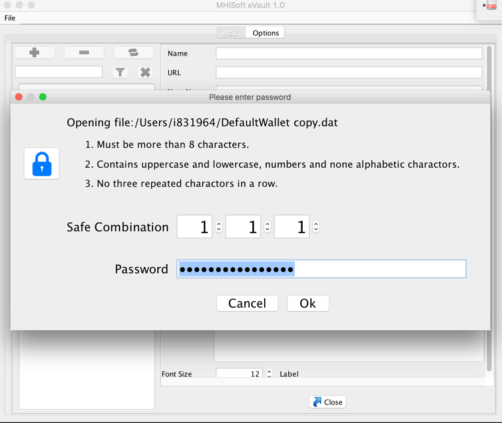
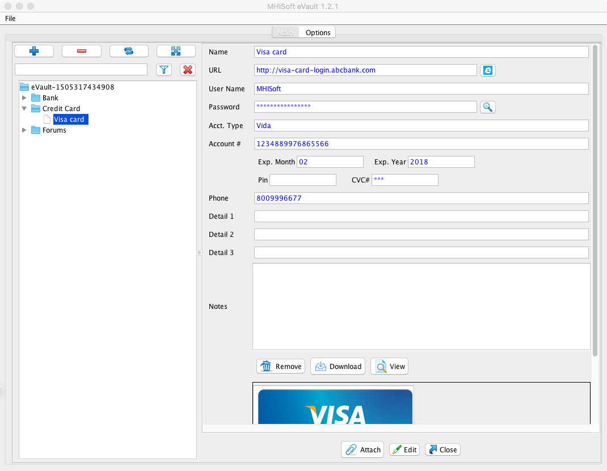

# eVault desktop application

A Java Swing application for managing an offline password vault, originally developed by [MHISoft](https://github.com/mhisoft/eVault).

## Features

- Organize vault entries into categories and search them.
- Create, open, save, back up, and import vault files.
- Attach documents and images to entries.
- Export entries and manage application settings.
- Close the vault after inactivity.

## Structure

| Path | Contents |
| --- | --- |
| [action](src/main/java/org/mhisoft/wallet/action/) | Application commands |
| [model](src/main/java/org/mhisoft/wallet/model/) | Vault entries and data types |
| [service](src/main/java/org/mhisoft/wallet/service/) | Storage and application services |
| [view](src/main/java/org/mhisoft/wallet/view/) | Swing interface and UI Designer forms |
| [tests](src/test/java/org/mhisoft/wallet/) | Application and data-service tests |

## Screenshots

## Build requirements

This legacy Maven module requires the sibling [common-utils](../common-utils/) library and a parent POM at `../parent-pom/pom.xml`. The parent POM is not included in this repository. Its historical dependencies and UI Designer plugin must also be resolved before building.

The [packaging directory](dist/) contains reference configuration and assets, not ready-to-run installers.

## Upstream documentation

See the [original repository](https://github.com/mhisoft/eVault) and [build documentation](https://github.com/mhisoft/eVault/wiki/How-to-build-from-the-source-code) for the upstream project.

## License

Application code: Apache License 2.0, as stated in the upstream documentation. Original source notices remain in place.

This README adapts the upstream project description. The original README grants modification and reuse under Creative Commons Attribution-ShareAlike 3.0 Unported and the GNU Free Documentation License (unversioned, with no invariant sections or cover texts); those documentation terms are retained here.

The upstream author disclaims responsibility for loss arising from use of the application.
